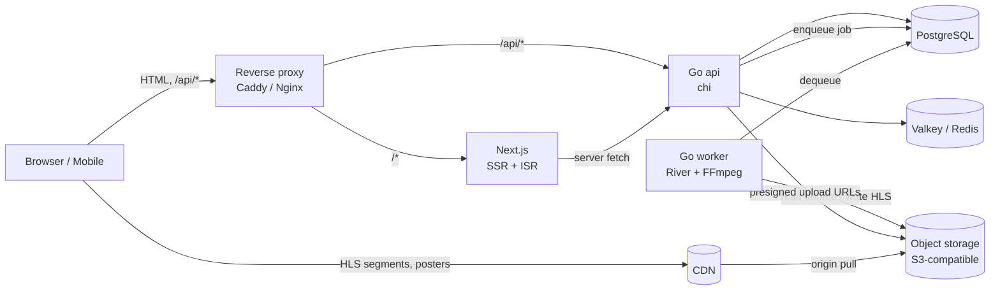

# Architecture Overview

> High-level system design: one monorepo, a modular-monolith Go backend with separate `api` and `worker` processes, and a Next.js frontend behind one domain. Back to [[00_Hub_KinoSite]].

## Decision 1 — Monorepo
**Yes, one repository** (`KinoSite/`) with `apps/api` (Go module) and `apps/web` (pnpm workspace).
- One PR changes an endpoint, its OpenAPI spec and the TS client together.
- TS types are **generated** from `api/openapi.yaml` (`openapi-typescript`) → the contract can't drift.
- Shared `docker-compose.yml`, CI and docs (this vault lives in `docs/`).
- Split later only if teams/deploy cadences diverge — the boundaries below make that cheap.

## Decision 2 — Modular monolith, not microservices
Microservices would add network hops, distributed transactions and N deploy pipelines to a prototype with one team. Instead:
- **One Go codebase**, split into **modules** with explicit boundaries (`catalog`, `media`, `playback`, `library`, `identity`, `admin`).
- Modules talk through Go interfaces, never through each other's tables.
- **Two binaries** from the same code: `cmd/api` (HTTP) and `cmd/worker` (FFmpeg transcoding). They scale independently: the worker is CPU-heavy and can run on a separate machine (or GPU box) without changing a line.
- The `media` module is the first candidate for extraction into a service later — it already communicates only through the job queue and object storage.

## System diagram

## Module map (Go)
| Module | Owns tables | Responsibility |
|---|---|---|
| `identity` | users, sessions, user_settings | register/login, sessions, profile |
| `catalog` | titles, seasons, episodes, genres, people, collections, trailers | browsing, search, home/feed composition |
| `media` | videos, video_renditions, uploads | uploads, transcode jobs, asset status |
| `playback` | — (reads videos) | issue signed manifest URLs, resume position |
| `library` | watch_progress, list_items, trailer_likes | history, watchlist, likes |
| `admin` | — (uses others' services) | CMS endpoints, publish → cache/ISR invalidation |

See [[03_Project_Structure]] for folders and [[04_Database_Schema]] for tables.

## Key request flows
### 1. Opening a title page (SEO path)
1. Crawler/user → `GET /films/severnyi-veter` → Next.js server component.
2. Next fetches `GET /api/v1/titles/severnyi-veter` (cached with tag `title:<id>`).
3. HTML with metadata + JSON-LD is returned; CDN can cache it.

### 2. Pressing «Смотреть»
1. Client → `POST /api/v1/videos/{id}/playback` (session cookie).
2. API checks: video `ready`, title published, user entitlement (free in MVP).
3. Returns `{ manifestUrl: "https://cdn…/t/{exp}/{sig}/v/{videoId}/master.m3u8", resumeAt: 312 }`.
4. Player loads HLS from CDN; edge validates the token. Details: [[06_Video_Pipeline#Secure delivery]].
5. Every 10 s the player sends `PUT /api/v1/me/progress/{videoId}` → Redis buffer → batch flush.

### 3. Uploading content (admin)
1. Admin → `POST /api/v1/admin/uploads` → API creates `videos` row (`status=uploading`) + S3 multipart presigned URLs.
2. Browser uploads directly to S3 (API never proxies gigabytes).
3. `POST /admin/uploads/{id}/complete` → API completes multipart and **in the same DB transaction** inserts a River job `transcode`.
4. Worker runs FFprobe → FFmpeg ladder → uploads HLS → marks `ready` → invalidates caches.

## Cross-cutting
- **Config**: env vars only (12-factor), parsed into a typed struct at startup.
- **Logging**: `log/slog` JSON, request id in every line.
- **Observability**: OpenTelemetry traces (HTTP → SQL → Redis), Prometheus `/metrics`; player QoE events (startup time, rebuffers) via `POST /api/v1/events` batched.
- **Security**: argon2id passwords, opaque session tokens (hash stored), CSRF via `SameSite=Lax` + `Origin` check on mutating requests, rate limits on auth, strict CSP, signed media URLs.
- **Deploy (MVP)**: one VM with Docker Compose (Caddy, web, api, worker, Postgres, Valkey) + managed object storage + CDN. Later: managed Postgres, worker autoscaling.

## Лог изменений
- 2026-11-01 — initial architecture.
