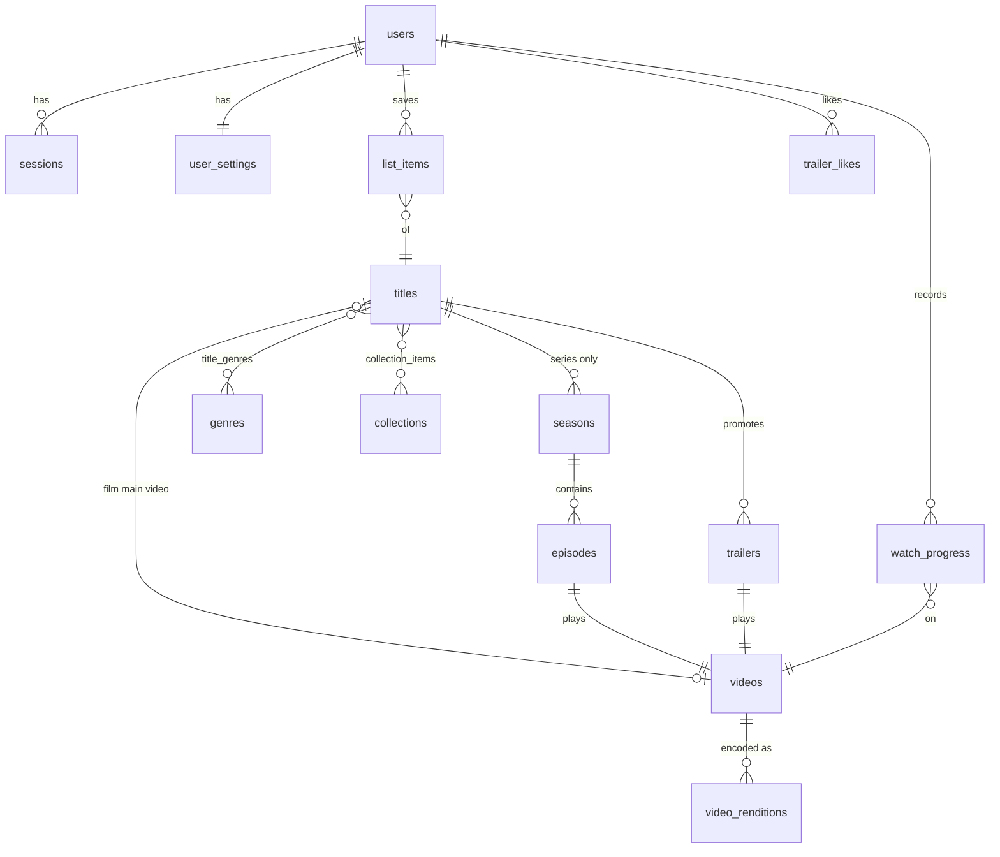

# Database Schema

> Key PostgreSQL tables and relationships for the MVP: catalog (films, series, seasons, episodes), media assets, users and their library. Back to [[00_Hub_KinoSite]].

## Modelling decisions
1. **`titles` unifies films and series** (`kind = 'film' | 'series'`). Both have the same card on rails, the same lists, the same search — one table avoids `UNION` everywhere.
2. **`videos` is the only playable thing.** A film points to its main video, an episode points to its video, a trailer points to its video. Playback, progress and transcoding all work on `video_id` — see [[06_Video_Pipeline]].
3. **Trailers are first-class** (the design's «Трейлеры» feed has kinds *Трейлер / Тизер / Фрагмент / Со съёмок*).
4. **«Катушки»** (reels) = `collections` + ordered `collection_items`.
5. IDs: `uuid` (v7 generated in Go → time-ordered, index-friendly); public URLs use `slug`.
6. Soft publishing: `published_at IS NOT NULL AND published_at <= now()` — enables scheduled premieres.

## ER diagram


## DDL (migration `00001_init.sql`)
```sql
-- +goose Up
CREATE EXTENSION IF NOT EXISTS pg_trgm;   -- typo-tolerant search
CREATE EXTENSION IF NOT EXISTS citext;    -- case-insensitive emails

-- ───────────── Identity ─────────────
CREATE TABLE users (
  id            uuid PRIMARY KEY,
  email         citext NOT NULL UNIQUE,
  handle        text   NOT NULL UNIQUE,          -- @maria.k
  display_name  text   NOT NULL,
  password_hash text   NOT NULL,                 -- argon2id encoded string
  role          text   NOT NULL DEFAULT 'viewer' CHECK (role IN ('viewer','admin')),
  created_at    timestamptz NOT NULL DEFAULT now()
);

CREATE TABLE sessions (
  token_hash  bytea PRIMARY KEY,                 -- sha256(token); raw token only in cookie
  user_id     uuid NOT NULL REFERENCES users(id) ON DELETE CASCADE,
  user_agent  text,
  created_at  timestamptz NOT NULL DEFAULT now(),
  expires_at  timestamptz NOT NULL
);
CREATE INDEX sessions_user_idx ON sessions(user_id);

-- Profile toggles from the design: Автозапуск / Звук сразу / Премьеры
CREATE TABLE user_settings (
  user_id          uuid PRIMARY KEY REFERENCES users(id) ON DELETE CASCADE,
  autoplay         boolean NOT NULL DEFAULT true,
  sound_on_start   boolean NOT NULL DEFAULT false,
  premiere_notify  boolean NOT NULL DEFAULT true
);

-- ───────────── Media ─────────────
CREATE TABLE videos (
  id             uuid PRIMARY KEY,
  status         text NOT NULL DEFAULT 'uploading'
                 CHECK (status IN ('uploading','queued','processing','ready','failed')),
  source_key     text NOT NULL,                  -- s3://media-src/{id}/source.mp4
  hls_prefix     text,                           -- v/{id}/{encode_version}/
  duration_ms    integer,
  width          integer,
  height         integer,
  orientation    text GENERATED ALWAYS AS
                 (CASE WHEN height > width THEN 'portrait' ELSE 'landscape' END) STORED,
  poster_key     text,                           -- frame / uploaded poster
  thumbs_vtt_key text,                           -- scrub preview sprites
  encode_version integer NOT NULL DEFAULT 0,     -- bump on re-encode → new immutable paths
  error          text,
  created_at     timestamptz NOT NULL DEFAULT now(),
  updated_at     timestamptz NOT NULL DEFAULT now()
);

CREATE TABLE video_renditions (
  video_id    uuid NOT NULL REFERENCES videos(id) ON DELETE CASCADE,
  name        text NOT NULL,                     -- '1080p', '720p', …
  width       integer NOT NULL,
  height      integer NOT NULL,
  bitrate_kbps integer NOT NULL,
  codec       text NOT NULL,                     -- 'avc1.640028'
  PRIMARY KEY (video_id, name)
);

-- ───────────── Catalog ─────────────
CREATE TABLE titles (
  id            uuid PRIMARY KEY,
  kind          text NOT NULL CHECK (kind IN ('film','series')),
  slug          text NOT NULL UNIQUE,
  title         text NOT NULL,                   -- «Северный ветер»
  logline       text NOT NULL DEFAULT '',        -- one-sentence pitch
  synopsis      text NOT NULL DEFAULT '',
  year          smallint,
  age_rating    text,                            -- '16+'
  runtime_min   integer,                         -- films; series = avg episode
  poster_key    text,                            -- 2:3
  cover_key     text,                            -- 9:16 vertical key art
  accent_color  text,                            -- poster fallback bg, e.g. '#1B2A6B'
  main_video_id uuid REFERENCES videos(id),      -- films only
  published_at  timestamptz,
  search        tsvector GENERATED ALWAYS AS (
                  setweight(to_tsvector('russian', coalesce(title,'')), 'A') ||
                  setweight(to_tsvector('russian', coalesce(logline,'')), 'B') ||
                  setweight(to_tsvector('russian', coalesce(synopsis,'')), 'C')
                ) STORED,
  created_at    timestamptz NOT NULL DEFAULT now(),
  updated_at    timestamptz NOT NULL DEFAULT now(),
  CHECK (kind = 'film' OR main_video_id IS NULL)
);
CREATE INDEX titles_search_idx    ON titles USING gin(search);
CREATE INDEX titles_trgm_idx      ON titles USING gin(title gin_trgm_ops);
CREATE INDEX titles_published_idx ON titles(published_at DESC) WHERE published_at IS NOT NULL;

CREATE TABLE seasons (
  id        uuid PRIMARY KEY,
  title_id  uuid NOT NULL REFERENCES titles(id) ON DELETE CASCADE,
  number    smallint NOT NULL,
  name      text,
  UNIQUE (title_id, number)
);

CREATE TABLE episodes (
  id           uuid PRIMARY KEY,
  season_id    uuid NOT NULL REFERENCES seasons(id) ON DELETE CASCADE,
  number       smallint NOT NULL,
  name         text NOT NULL,
  synopsis     text NOT NULL DEFAULT '',
  video_id     uuid NOT NULL UNIQUE REFERENCES videos(id),
  published_at timestamptz,
  UNIQUE (season_id, number)
);

CREATE TABLE trailers (
  id           uuid PRIMARY KEY,
  title_id     uuid NOT NULL REFERENCES titles(id) ON DELETE CASCADE,
  kind         text NOT NULL CHECK (kind IN ('trailer','teaser','clip','bts')),
  name         text NOT NULL,
  note         text NOT NULL DEFAULT '',        -- the feed's caption
  video_id     uuid NOT NULL UNIQUE REFERENCES videos(id),
  feed_rank    integer NOT NULL DEFAULT 0,      -- editorial boost in the feed
  published_at timestamptz
);
CREATE INDEX trailers_feed_idx ON trailers(feed_rank DESC, published_at DESC)
  WHERE published_at IS NOT NULL;

CREATE TABLE genres (
  id   smallserial PRIMARY KEY,
  slug text NOT NULL UNIQUE,                    -- 'drama'
  name text NOT NULL                            -- 'Драма'
);
CREATE TABLE title_genres (
  title_id uuid     NOT NULL REFERENCES titles(id) ON DELETE CASCADE,
  genre_id smallint NOT NULL REFERENCES genres(id),
  PRIMARY KEY (title_id, genre_id)
);

-- «Катушки»: curated reels
CREATE TABLE collections (
  id           uuid PRIMARY KEY,
  slug         text NOT NULL UNIQUE,
  name         text NOT NULL,                   -- 'Нуар и ночь'
  description  text NOT NULL DEFAULT '',
  accent_color text,
  position     integer NOT NULL DEFAULT 0,      -- order on the home page
  published_at timestamptz
);
CREATE TABLE collection_items (
  collection_id uuid NOT NULL REFERENCES collections(id) ON DELETE CASCADE,
  title_id      uuid NOT NULL REFERENCES titles(id) ON DELETE CASCADE,
  position      integer NOT NULL,
  PRIMARY KEY (collection_id, title_id)
);

-- ───────────── Library (per user) ─────────────
CREATE TABLE watch_progress (
  user_id     uuid NOT NULL REFERENCES users(id) ON DELETE CASCADE,
  video_id    uuid NOT NULL REFERENCES videos(id) ON DELETE CASCADE,
  position_ms integer NOT NULL,
  duration_ms integer NOT NULL,
  completed   boolean NOT NULL DEFAULT false,   -- set when position > 92% of duration
  updated_at  timestamptz NOT NULL DEFAULT now(),
  PRIMARY KEY (user_id, video_id)
);
-- «Недавно смотрели» rail
CREATE INDEX watch_progress_recent_idx ON watch_progress(user_id, updated_at DESC);

-- «Хочу посмотреть» / «Понравилось»
CREATE TABLE list_items (
  user_id    uuid NOT NULL REFERENCES users(id) ON DELETE CASCADE,
  list       text NOT NULL CHECK (list IN ('watchlist','liked')),
  title_id   uuid NOT NULL REFERENCES titles(id) ON DELETE CASCADE,
  created_at timestamptz NOT NULL DEFAULT now(),
  PRIMARY KEY (user_id, list, title_id)
);
CREATE INDEX list_items_recent_idx ON list_items(user_id, list, created_at DESC);

CREATE TABLE trailer_likes (
  user_id    uuid NOT NULL REFERENCES users(id) ON DELETE CASCADE,
  trailer_id uuid NOT NULL REFERENCES trailers(id) ON DELETE CASCADE,
  created_at timestamptz NOT NULL DEFAULT now(),
  PRIMARY KEY (user_id, trailer_id)
);

-- +goose Down
DROP TABLE IF EXISTS trailer_likes, list_items, watch_progress, collection_items, collections,
  title_genres, genres, trailers, episodes, seasons, titles, video_renditions, videos,
  user_settings, sessions, users CASCADE;
```

## watch_progress
The player reports position every ~10 s. With 1 000 concurrent viewers that is 100 writes/s of near-duplicate rows → we **buffer in Valkey** and flush in batches:

```go
// internal/library/progress.go
// Save stores the latest position in a Redis hash; a ticker flushes dirty keys to Postgres.
func (s *ProgressService) Save(ctx context.Context, userID, videoID uuid.UUID, posMs, durMs int) error {
	key := "v1:progress:dirty"
	field := userID.String() + ":" + videoID.String()
	val := fmt.Sprintf("%d:%d:%d", posMs, durMs, time.Now().Unix())
	// HSET overwrites → only the latest position per (user, video) survives until flush.
	return s.rdb.HSet(ctx, key, field, val).Err()
}

// Flush runs every 15 s in the api process (one instance holds a Redis lock).
func (s *ProgressService) Flush(ctx context.Context) error {
	// Atomically take the current batch: rename → read → delete.
	if err := s.rdb.Rename(ctx, "v1:progress:dirty", "v1:progress:flushing").Err(); err != nil {
		return nil // nothing dirty (ERR no such key)
	}
	rows, err := s.rdb.HGetAll(ctx, "v1:progress:flushing").Result()
	if err != nil {
		return err
	}
	// One multi-row UPSERT via sqlc :copyfrom into a temp table, or a pgx.Batch.
	if err := s.repo.UpsertProgressBatch(ctx, parseRows(rows)); err != nil {
		return err // key stays → retried next tick
	}
	return s.rdb.Del(ctx, "v1:progress:flushing").Err()
}
```

The UPSERT keeps the newest write and sets `completed`:
```sql
-- name: UpsertProgress :exec
INSERT INTO watch_progress (user_id, video_id, position_ms, duration_ms, completed, updated_at)
VALUES ($1, $2, $3, $4, $3 >= $4 * 0.92, $5)
ON CONFLICT (user_id, video_id) DO UPDATE
SET position_ms = EXCLUDED.position_ms,
    duration_ms = EXCLUDED.duration_ms,
    completed   = watch_progress.completed OR EXCLUDED.completed,
    updated_at  = EXCLUDED.updated_at
WHERE EXCLUDED.updated_at > watch_progress.updated_at;  -- ignore out-of-order writes
```

## Useful queries (sqlc)
```sql
-- name: ContinueWatching :many
-- «Недавно смотрели»: one row per title, resolving episodes back to their series.
SELECT DISTINCT ON (t.id)
       t.id, t.slug, t.title, t.kind, t.poster_key, t.cover_key, t.accent_color,
       wp.video_id, wp.position_ms, wp.duration_ms, wp.updated_at
FROM watch_progress wp
LEFT JOIN episodes e ON e.video_id = wp.video_id
LEFT JOIN seasons  s ON s.id = e.season_id
JOIN titles t ON t.id = COALESCE(s.title_id, (SELECT id FROM titles WHERE main_video_id = wp.video_id))
WHERE wp.user_id = $1
ORDER BY t.id, wp.updated_at DESC
LIMIT 20;

-- name: SearchTitles :many
SELECT id, slug, title, kind, poster_key,
       ts_rank(search, websearch_to_tsquery('russian', $1)) AS rank
FROM titles
WHERE published_at <= now()
  AND (search @@ websearch_to_tsquery('russian', $1) OR title % $1)  -- FTS or trigram
ORDER BY rank DESC, similarity(title, $1) DESC
LIMIT 20;
```
> `ContinueWatching` re-sorts by `updated_at` in Go after `DISTINCT ON` (or wrap it in a subquery).

## Лог изменений
- 2026-11-01 — initial schema (16 tables).
