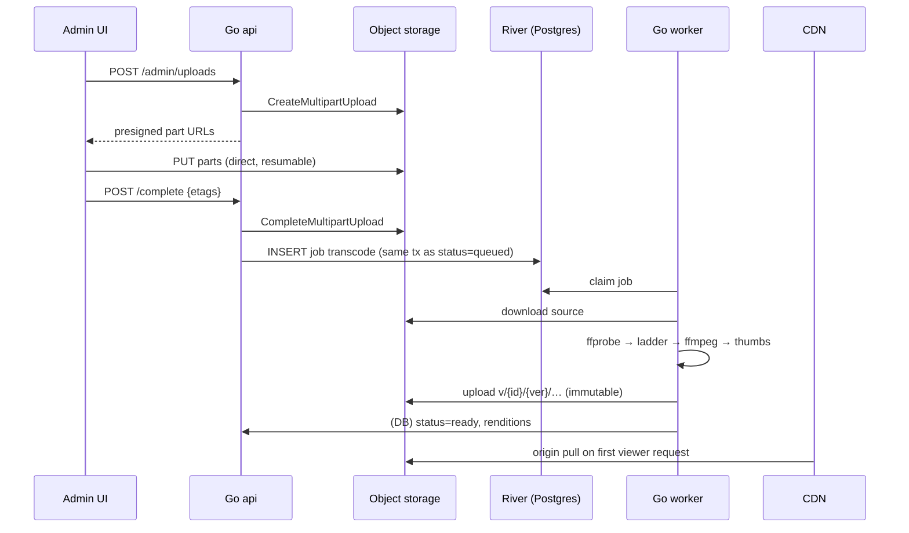

# Video Delivery Strategy

> How a source file becomes adaptive HLS on a CDN: direct upload, FFmpeg transcoding in a Go worker, CMAF packaging, immutable storage and token-protected delivery. Back to [[00_Hub_KinoSite]].

## Pipeline


## Format decision: HLS with CMAF (fMP4) segments, no separate DASH
- **One packaging serves everyone**: Safari/iOS play HLS natively; Chrome/Firefox/Edge/Android via hls.js (MSE).
- **CMAF fMP4** segments (not MPEG-TS) are DASH-compatible — if DASH or DRM (Widevine/FairPlay via CENC) is needed later, add a DASH manifest over the **same** segments, no re-encode.
- DASH alone doesn't play natively on iOS → HLS is the mandatory one.

## Encoding ladder
The design is **vertical-first** (9:16 trailers). Orientation is detected with `ffprobe`; the worker chooses a ladder:

| Rung | Portrait (9:16) | Landscape (16:9) | Video kbps (max) | Audio |
|---|---|---|---|---|
| 1080p | 1080×1920 | 1920×1080 | 5000 | AAC 128k |
| 720p | 720×1280 | 1280×720 | 2800 | AAC 128k |
| 540p | 540×960 | 960×540 | 1400 | AAC 96k |
| 360p | 360×640 | 640×360 | 700 | AAC 64k |

- Codec: **H.264 High** (universal). Add HEVC/AV1 rungs later for bandwidth savings.
- Never upscale: rungs above the source height are skipped.
- **GOP aligned** to segment length (`-g`/`-keyint_min` = fps × 2, `-sc_threshold 0`) so ABR switches are seamless.
- **Segments: 2 s** for trailers/feed (fast start when swiping), 4 s for long films (fewer requests). Prototype: 2 s everywhere is fine.
- Audio normalised with `loudnorm` (−16 LUFS) so swiping between trailers doesn't jump in volume.
- Extras: poster frame (`-ss 10%`), **thumbnail sprite + WebVTT** for scrub previews, optional 3 s silent MP4 preview for hover.

## Storage layout (S3-compatible)
```text
media-src/                       # private bucket: originals, never public
  {video_id}/source.mp4
media-hls/                       # CDN origin (private, CDN-only access)
  v/{video_id}/{encode_version}/
    master.m3u8
    1080p/index.m3u8  1080p/init.mp4  1080p/seg_00001.m4s …
    720p/…  540p/…  360p/…
    thumbs.vtt  thumbs_0.jpg
img/                             # posters/covers, served via image resizer
```
- `encode_version` in the path ⇒ every file is **immutable** → `Cache-Control: public, max-age=31536000, immutable`. Re-encode = new path, no CDN purge needed.
- Providers: dev **MinIO**; prod for RU audience **Selectel / Yandex Cloud Object Storage + their CDN**; global **Cloudflare R2** (no egress fees) **+ Cloudflare CDN**, or **AWS S3 + CloudFront**.

## Worker: FFmpeg invocation (Go)
```go
// internal/media/transcode/worker.go
// TranscodeArgs is the River job payload (stored as JSON in Postgres).
type TranscodeArgs struct {
	VideoID uuid.UUID `json:"video_id"`
	Version int       `json:"version"`
}

func (TranscodeArgs) Kind() string { return "transcode" }

// InsertOpts: one attempt at a time per video, up to 3 retries.
func (TranscodeArgs) InsertOpts() river.InsertOpts {
	return river.InsertOpts{Queue: "media", MaxAttempts: 3,
		UniqueOpts: river.UniqueOpts{ByArgs: true}}
}

type Worker struct {
	river.WorkerDefaults[TranscodeArgs]
	store  storage.Store
	videos VideoRepo
}

func (w *Worker) Work(ctx context.Context, job *river.Job[TranscodeArgs]) error {
	dir, err := os.MkdirTemp("", "tc-*") // scratch space, removed at the end
	if err != nil {
		return err
	}
	defer os.RemoveAll(dir)

	src := filepath.Join(dir, "source")
	if err := w.store.Download(ctx, srcKey(job.Args.VideoID), src); err != nil {
		return err
	}
	probe, err := Probe(ctx, src) // ffprobe -show_streams -of json
	if err != nil {
		return w.fail(ctx, job.Args.VideoID, err)
	}
	_ = w.videos.SetStatus(ctx, job.Args.VideoID, "processing")

	ladder := LadderFor(probe.Width, probe.Height) // portrait/landscape, no upscaling
	out := filepath.Join(dir, "hls")
	cmd := exec.CommandContext(ctx, "ffmpeg", BuildHLSArgs(src, out, ladder, probe.FPS)...)
	cmd.Stderr = newProgressLogger(job) // parse "time=" lines → progress %
	if err := cmd.Run(); err != nil {
		return w.fail(ctx, job.Args.VideoID, fmt.Errorf("ffmpeg: %w", err))
	}
	prefix := fmt.Sprintf("v/%s/%d/", job.Args.VideoID, job.Args.Version)
	if err := w.store.UploadDir(ctx, out, prefix, immutableHeaders); err != nil {
		return err // retried by River
	}
	return w.videos.MarkReady(ctx, job.Args.VideoID, prefix, probe, ladder)
}
```

```go
// internal/media/transcode/ffmpeg.go
// BuildHLSArgs produces a single ffmpeg run that encodes every rung and writes CMAF HLS.
func BuildHLSArgs(src, outDir string, ladder []Rung, fps float64) []string {
	gop := strconv.Itoa(int(math.Round(fps * 2))) // keyframe every 2 s = segment length
	args := []string{"-hide_banner", "-y", "-i", src}

	// split the video once, scale each branch to its rung.
	filter := fmt.Sprintf("[0:v]split=%d", len(ladder))
	for i := range ladder {
		filter += fmt.Sprintf("[v%d]", i)
	}
	for i, r := range ladder {
		filter += fmt.Sprintf(";[v%d]scale=w=%d:h=%d:flags=lanczos[v%dout]", i, r.W, r.H, i)
	}
	args = append(args, "-filter_complex", filter)

	var streamMap []string
	for i, r := range ladder {
		k := strconv.Itoa(i)
		args = append(args,
			"-map", "[v"+k+"out]",
			"-c:v:"+k, "libx264", "-profile:v:"+k, "high", "-preset", "veryfast",
			"-b:v:"+k, r.Kbps+"k", "-maxrate:v:"+k, r.MaxKbps+"k", "-bufsize:v:"+k, r.BufKbps+"k",
			"-g", gop, "-keyint_min", gop, "-sc_threshold", "0",
			"-map", "a:0?", "-c:a:"+k, "aac", "-b:a:"+k, r.AudioKbps+"k", "-ac", "2",
		)
		streamMap = append(streamMap, fmt.Sprintf("v:%d,a:%d,name:%s", i, i, r.Name))
	}
	args = append(args,
		"-af", "loudnorm=I=-16:TP=-1.5:LRA=11", // even loudness across trailers
		"-f", "hls",
		"-hls_time", "2",
		"-hls_playlist_type", "vod",
		"-hls_segment_type", "fmp4", // CMAF
		"-hls_fmp4_init_filename", "init.mp4",
		"-hls_segment_filename", filepath.Join(outDir, "%v", "seg_%05d.m4s"),
		"-master_pl_name", "master.m3u8",
		"-var_stream_map", strings.Join(streamMap, " "),
		filepath.Join(outDir, "%v", "index.m3u8"),
	)
	return args
}
```
> Videos without audio: drop the `a:` mapping (the `?` makes `-map` optional but `var_stream_map` must match — build it from `probe.HasAudio`).

## Secure delivery
Goals: no hot-linking, links expire, the API controls who watches — without proxying video bytes through Go.

**Path-based token** (key trick): HLS playlists reference children by **relative** URLs. A query-string token on `master.m3u8` is *not* carried to `720p/index.m3u8` or segments. A token in the **path prefix** is inherited automatically:

```text
https://cdn.kadr.example/t/{exp}/{sig}/v/{video_id}/{ver}/master.m3u8
                         └─────── token ───────┘└──── object key ────┘
sig = base64url( HMAC-SHA256(secret, "{exp}|v/{video_id}/{ver}/") )
```
- Edge validates `exp > now` and the HMAC for the prefix, strips `/t/{exp}/{sig}` and fetches the object from origin. Implemented as a Cloudflare Worker / CloudFront Function / the CDN's "secure token" feature; in dev, a tiny Go handler does the same in front of MinIO.
- TTL ≈ duration + 2 h; the player calls `/playback` again if a 403 appears (long pauses).
- Origin bucket accepts requests **only** from the CDN (origin auth / private bucket + signed origin requests).

```go
// internal/playback/signer.go
// Sign returns a CDN URL whose path prefix authorises every file under the video's HLS folder.
func (s *Signer) Sign(videoID uuid.UUID, version int, ttl time.Duration) (string, time.Time) {
	exp := time.Now().Add(ttl).Unix()
	prefix := fmt.Sprintf("v/%s/%d/", videoID, version)

	mac := hmac.New(sha256.New, s.secret)
	fmt.Fprintf(mac, "%d|%s", exp, prefix) // binds expiry + folder
	sig := base64.RawURLEncoding.EncodeToString(mac.Sum(nil))

	return fmt.Sprintf("%s/t/%d/%s/%smaster.m3u8", s.cdnBase, exp, sig, prefix), time.Unix(exp, 0)
}

// Verify is used by the dev edge proxy (and mirrors the CDN worker logic).
func (s *Signer) Verify(exp int64, sig, prefix string) bool {
	if time.Now().Unix() > exp {
		return false
	}
	mac := hmac.New(sha256.New, s.secret)
	fmt.Fprintf(mac, "%d|%s", exp, prefix)
	want := base64.RawURLEncoding.EncodeToString(mac.Sum(nil))
	return hmac.Equal([]byte(want), []byte(sig)) // constant-time compare
}
```

**Levels of protection (pick per content):**
1. MVP: path tokens + private origin (above). Stops hot-linking and link sharing after expiry.
2. HLS **AES-128** encryption with a key URL served by the Go API (auth-checked). Cheap; stops casual downloaders.
3. Premium content: **DRM** (FairPlay + Widevine via CENC/CBCS on the same CMAF segments) through a multi-DRM vendor. Out of MVP scope.

## Player behaviour (feed)
- Preload: when trailer *n* plays, create the hls.js instance for *n+1* with `autoStartLoad: true` and `startLevel` = lowest rung → instant start on swipe; destroy instances further than ±1 to save memory.
- Muted autoplay by default (browser policy) — respects the user's `sound_on_start` setting ([[04_Database_Schema]] `user_settings`) after the first user gesture.
- Details and code: [[07_Frontend_Design_Integration#Player]].

## Лог изменений
- 2026-11-01 — pipeline, ladder, signing scheme.
