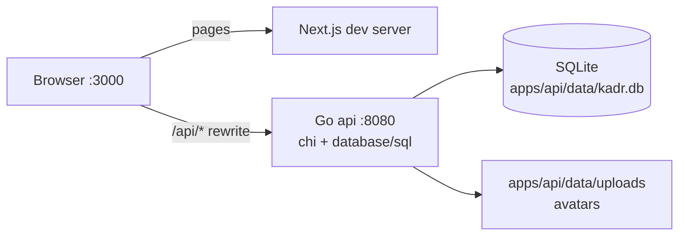

# 1-Day Prototype Plan

> The plan that replaces [[08_Roadmap]] for the first demo: three screens from the «Плёнка» design, running locally, backed by a small Go API and SQLite. [[08_Roadmap]] stays as the plan for later phases. Back to [[00_Hub_KinoSite]].

## Goal
A clickable, locally running website that shows the idea: a catalog of short films and series, a vertical trailer feed and a user profile. The look follows the design «Г · Плёнка» 1:1. **Time budget: 1 day. Desktop (1440) and phones. Russian UI.**

## Decisions (from the Q&A on 2026-11-01)
| # | Topic | Decision |
|---|---|---|
| 1 | Screens | Exactly 3: **Фильмы** `/`, **Трейлеры** `/trailers`, **Профиль** `/profile`. No film/series/episode/search/catalog/login pages |
| 2 | Video | **None.** Every "video" and poster is an abstract colour block, as in the design |
| 3 | Upload / transcoding / CDN | Not built |
| 4 | Environment | Local only |
| 5 | Auth | One demo user, **signed in automatically**. «Выйти» signs out; the profile then shows «Войти как демо» |
| 6 | «Катушки» | Collections of titles (films or series) |
| 7 | «Трейлер недели» | Whatever trailer the administrator picks (`site_settings.hero_trailer_id`, set with `go run ./cmd/admin hero <slug>`) |
| 8 | «Недавно смотрели», stats line | Shown as in the design, with static data. Not wired to the API |
| 9 | «Поделиться» | Stub. **«Редактировать профиль»** edits the display name, @handle and avatar (image upload). Settings toggles: shown as in the design, but not saved |
| 10 | Release labels («в кино с 12 ноября») | Plain text from the seed, no logic |
| 11 | Mobile | Supported (added after the first build): full-screen swipeable feed, smaller tokens below 768 px. Navigation on all sizes is a floating bottom island |
| 12 | Infra | **No** Valkey, River, S3/MinIO, OpenTelemetry, rate limits, ISR, OpenAPI codegen, Docker |
| 13 | Access | Everything is free. Nothing on the site mentions pricing |
| 14 | Content | The design's fictional titles, from a JSON seed file. A real open dataset replaces the seed file in a later step |
| — | Database | **SQLite** (pure-Go driver `modernc.org/sqlite`, no CGO, no Docker). The SQL stays Postgres-compatible where possible |

## MVP scope
### Built and working
- **Фильмы**: header (logo, 3 tabs), hero «Трейлер недели» chosen by the admin, «Хочу посмотреть» toggle on the hero (saved), «Новое в библиотеке» film strip (newest titles from the DB), «Катушки» grid (collections from the DB, with title counts).
- **Трейлеры**: feed from the DB, prev/next with buttons and the ↑/↓ keys, «1 из N», **«Нравится»** and **«Хочу посмотреть»** saved per user, links from a reel open the feed filtered to that reel's titles.
- **Профиль**: name, @handle and avatar from the DB; an edit dialog (name, handle, avatar upload); «Списки» tabs read real `watchlist` / `liked` lists («Нравится» in the feed is the same as «Понравилось» for that title, so there is no separate trailer-likes table); sign out and sign back in.
- **Go API**: about 12 endpoints, a session cookie, an embedded schema and seed applied on first start.

### Visual only (design, no logic)
- Trailer player controls (pause, progress bar), «Звук», «Поделиться», the search button, «Весь каталог», «Страница фильма».
- «Недавно смотрели» strip and the "48 трейлеров за осень" line.
- «Настройки» switches (they toggle in the page but are not saved).

### Deferred (later phases, see [[08_Roadmap]])
Video playback and the HLS pipeline, real datasets, title, series, episode, search and catalog pages, real registration, watch history, settings persistence, Postgres, caching, SEO, deployment.

## Architecture (prototype)

- Next.js rewrites `/api/*` to Go, so the cookie stays first-party and no CORS is needed.
- Pages are client components that call the API. SSR and SEO are not goals for the demo.

### Data model (SQLite)
`users`, `sessions`, `titles` (kind, slug, title, logline, genre, runtime, `art_bg/art_ink/art_shape`), `trailers` (kind, name, note, length, release label, feed rank), `collections` + `collection_items`, `list_items` (`watchlist`/`liked`), `site_settings`.

### API (`/api/v1`)
| Method | Path | Purpose |
|---|---|---|
| GET | `/home` | hero trailer + its title, «Новое» rail, reels |
| GET | `/feed/trailers?collection=&kind=&max_min=&genre=` | the feed, filtered by reel, film/series, max length (film or one episode) and genres |
| GET | `/genres?kind=` | genres for the feed's filter panel |
| GET | `/me` | current user (401 when signed out) |
| PATCH | `/me` | `{display_name, handle}` |
| POST | `/me/avatar` | multipart image upload (≤ 2 MB, png/jpg/webp) |
| GET | `/me/lists/{list}` | `watchlist` or `liked` titles |
| PUT/DELETE | `/me/lists/{list}/{titleId}` | add or remove |
| POST | `/auth/demo` | sign in as the demo user |
| POST | `/auth/logout` | sign out |
| GET | `/uploads/{file}` | avatar files |

Auto sign-in: when a request has no session cookie and no `kadr_signed_out` cookie, the API creates a demo session. Logout sets `kadr_signed_out`, and `/auth/demo` clears it.

## Step-by-step
1. **Repo skeleton**: `apps/api` (Go module), `apps/web` (Next.js + Tailwind v4), root README with run commands. *(≈30 min)*
2. **Backend**: schema + JSON seed (embedded), store layer, handlers, session middleware, avatar upload, `cmd/admin hero <slug>`. *(≈2.5 h)*
3. **Frontend foundation**: `tokens.css` from [[07_Frontend_Design_Integration]], Jost, header, the design's logo and icons, the shared pieces (Sprockets, FilmStrip, PosterCard, Art block, Switch). *(≈1.5 h)*
4. **Screens**: Фильмы → Трейлеры → Профиль, wired to the API. *(≈3 h)*
5. **Check end to end**: start both servers, click through all three pages, like and save, edit the profile, sign out and in. *(≈1 h)*

**Done when:** `go run ./cmd/api` plus `npm run dev` open a site that matches the design, and a like or a profile edit survives a reload.

## Run
```bash
cd apps/api && go run ./cmd/api          # :8080, creates data/kadr.db on first start
cd apps/web && npm install && npm run dev # :3000
cd apps/api && go run ./cmd/admin hero ogni-porta   # change «Трейлер недели»
```

## Лог изменений
- 2026-11-01 — created from the Q&A; supersedes [[08_Roadmap]] for the first demo.
